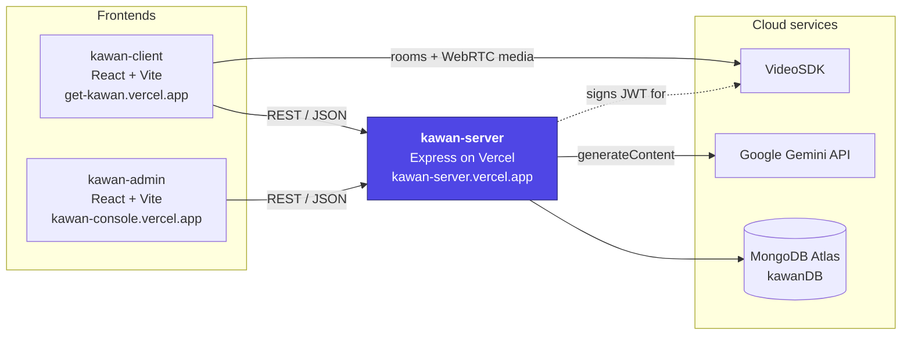
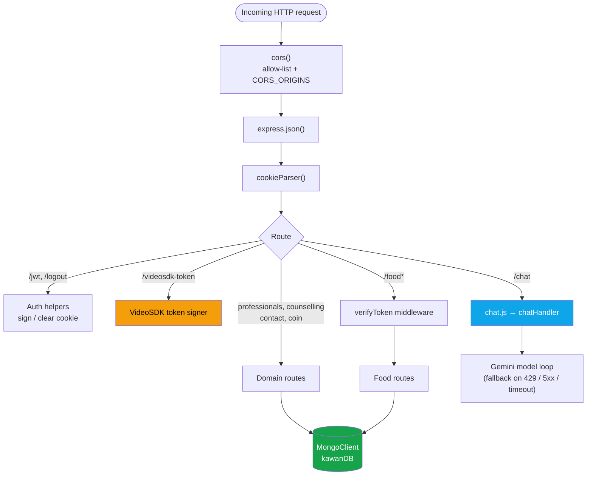
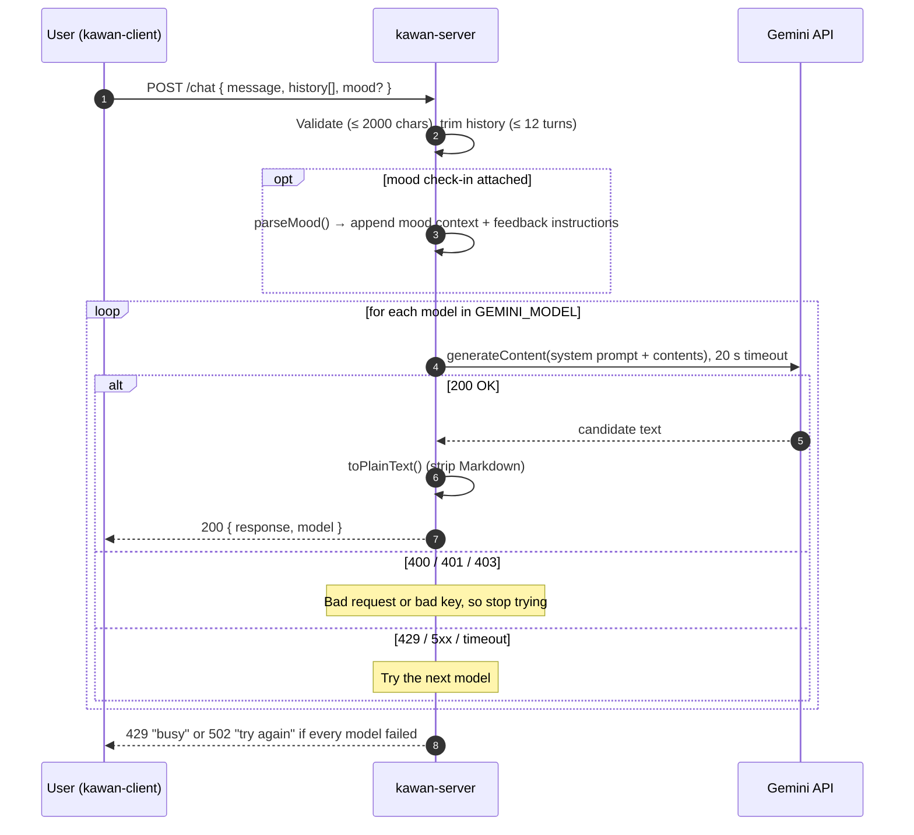
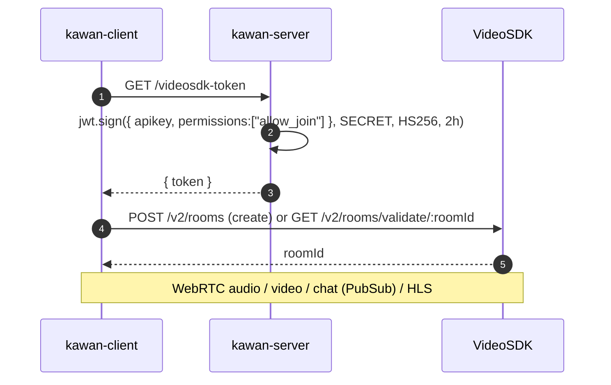
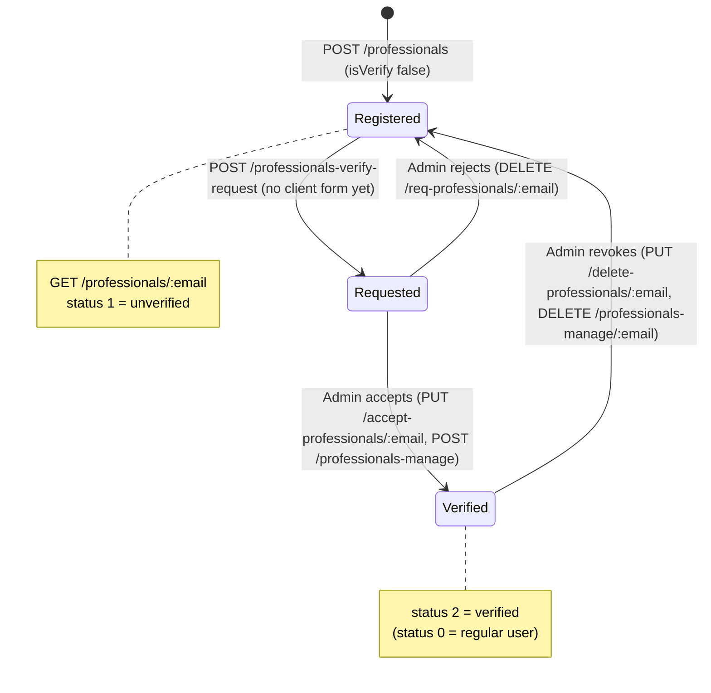
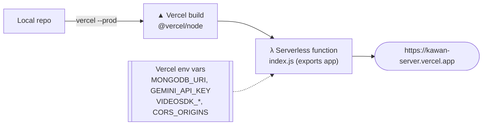

<div align="center">

# KAWAN Server

**REST API for KAWAN, a mental health and self-development platform**

Node.js, Express, MongoDB Atlas, Google Gemini, VideoSDK, Vercel Serverless

[](https://kawan-server.vercel.app)
[](https://nodejs.org)
[](https://expressjs.com)
[](https://www.mongodb.com/atlas)

</div>

---

## Table of Contents

- [Overview](#overview)
- [Where this repo fits](#where-this-repo-fits)
- [Tech Stack](#tech-stack)
- [Architecture](#architecture)
- [Request Flows](#request-flows)
- [Data Model](#data-model)
- [API Overview](#api-overview)
- [Project Structure](#project-structure)
- [Getting Started](#getting-started)
- [Environment Variables](#environment-variables)
- [Deployment](#deployment)
- [Troubleshooting](#troubleshooting)
- [Known Limitations](#known-limitations)
- [Related Repositories](#related-repositories)
- [License](#license)
- [Author](#author)

---

## Overview

`kawan-server` is the backend for the KAWAN platform. It serves two React frontends, [kawan-client](https://github.com/mahfuzhasanreza/kawan-client) (users and professionals) and [kawan-admin](https://github.com/mahfuzhasanreza/kawan-admin) (administrators), and handles:

| Area | What the server does |
|---|---|
| **AI chatbot** | Proxies chat turns to **Google Gemini** so the API key stays on the server. It falls back through a list of models and can add context from a camera **mood check-in**. |
| **Video counselling** | Signs short-lived **VideoSDK** JWTs (`allow_join`, 2 h) so the VideoSDK secret never reaches the browser. |
| **Professionals** | Registers professionals and lets admins verify or revoke them. |
| **Counselling requests** | Endpoints for user → professional session requests and accepted sessions (no client UI yet). |
| **Contact** | Stores messages from the "Contact Us" form for admins to review. |
| **Auth helpers** | Issues and clears a JWT in an `httpOnly` cookie (`/jwt`, `/logout`); `verifyToken` protects the food routes. |
| **Food sharing (legacy)** | CRUD for an earlier food donation module; not used by the current frontends. |

---

## Where this repo fits



---

## Tech Stack

| Concern | Technology |
|---|---|
| Runtime | Node.js 18+ (uses the built-in `fetch` / `AbortController`) |
| Web framework | Express 4 |
| Database | MongoDB Atlas via the official `mongodb` v6 driver (Stable API v1) |
| Auth | `jsonwebtoken` + `cookie-parser` (httpOnly cookie) |
| AI | Google Gemini REST API (`v1beta/models/*:generateContent`) |
| Video | VideoSDK token signing (HS256) |
| Config | `dotenv` |
| CORS | `cors` with an allow-list |
| Hosting | Vercel Serverless Functions (`@vercel/node`) |

---

## Architecture

### Internal layout



**Design notes**

- **Serverless-friendly start-up.** Routes are registered synchronously and `client.connect()` runs in the background, so a Vercel cold start can serve requests right away. The driver also connects lazily on the first query.
- **Same code locally and on Vercel.** `index.js` exports the Express `app`. It calls `app.listen()` only when `process.env.VERCEL` is not set.
- **Secrets stay server-side.** The Gemini API key and the VideoSDK secret are read only on the server, never shipped to a bundle.
- **Resilience.** A global `unhandledRejection` handler keeps the process alive if a DB operation fails outside a request.
- **Dependency shim.** `shims/buffer-equal-constant-time` replaces a transitive dependency of `jsonwebtoken` through `package.json → overrides`, which keeps it working on newer Node versions.

---

## Request Flows

### 1. AI chatbot (`POST /chat`)



The system prompt makes **Kawan** a warm, non-judgemental companion. It replies in the user's language (e.g. Bangla or English), writes plain text, never diagnoses, points users to KAWAN's verified professionals for serious issues, and gives crisis guidance if self-harm is mentioned.

### 2. Video counselling token (`GET /videosdk-token`)



### 3. Professional verification lifecycle



The cookie JWT flow used by the legacy food routes is in [docs/API.md](docs/API.md#cookie-jwt-flow).

---

## Data Model

Everything is stored in one MongoDB database, `kawanDB`. Collections are linked by email address.

| Collection | Holds |
|---|---|
| `professionals` | Professional accounts and their `isVerify` flag |
| `verify-request` / `verified-professionals` | The verification queue and the approved list |
| `req-counselling` / `acc-counselling` | Session requests and accepted sessions |
| `contact` | Contact Us messages |
| `coin`, `foods`, `requestedFoods`, `all-counselling` | Unused or legacy |

Fields, relationships and role codes: **[docs/DATABASE.md](docs/DATABASE.md)**

---

## API Overview

| Group | Endpoints | Used by |
|---|---|---|
| System | `GET /`, `GET /videosdk-token`, `POST /jwt`, `POST /logout` | client (`/videosdk-token` only) |
| Chatbot | `POST /chat` | client |
| Professionals | `/professionals`, `/req-professionals`, `/accept-professionals`, `/professionals-manage`, … | client, admin |
| Counselling | `/req-counselling`, `/req-live-*`, `/live`, `/live-details-*` | not used yet |
| Contact | `/contact` | client, admin |
| Food (legacy) | `/food`, `/request-food`, `/food-requests`, `/available-foods` | not used |

Every endpoint with its request body, responses and examples: **[docs/API.md](docs/API.md)**

---

## Project Structure

```
kawan-server/
├── index.js            # Express app: middleware, CORS, auth, MongoDB, all REST routes
├── chat.js             # POST /chat: Gemini client, system prompt, mood context, model fallback
├── docs/
│   ├── API.md          # Full endpoint reference
│   └── DATABASE.md     # Collections, fields, relationships
├── shims/
│   └── buffer-equal-constant-time/   # Drop-in replacement wired via package.json "overrides"
├── vercel.json         # Routes every path/method to index.js (@vercel/node)
├── package.json
└── .env                # Local secrets (git-ignored)
```

---

## Getting Started

### Prerequisites

- **Node.js 18+** (needs global `fetch`)
- A **MongoDB Atlas** cluster (or any MongoDB URI)
- A **Gemini API key** from [Google AI Studio](https://aistudio.google.com/app/apikey)
- A **VideoSDK** API key and secret from [app.videosdk.live/api-keys](https://app.videosdk.live/api-keys)

### Install & run

```bash
git clone https://github.com/mahfuzhasanreza/kawan-server.git
cd kawan-server
npm install
# create .env (see Environment Variables below)
npm start               # → http://localhost:5000
```

Check that it works:

```bash
curl http://localhost:5000/          # kawan server is running
curl http://localhost:5000/videosdk-token
```

Then point the frontends at it with `VITE_SERVER_URL=http://localhost:5000`. `http://localhost:5173` and `:5174` are already in the CORS allow-list.

---

## Environment Variables

Create `.env` in the project root:

```env
# --- Server ---
PORT=5000
NODE_ENV=development            # "production" → cookies become SameSite=None; Secure

# --- MongoDB (use MONGODB_URI, or DB_USER + DB_PASS for the default cluster) ---
MONGODB_URI="mongodb+srv://<user>:<url-encoded-password>@<cluster>.mongodb.net/?retryWrites=true&w=majority"
DB_USER=YOUR_DATABASE_USERNAME
DB_PASS=YOUR_DATABASE_PASSWORD

# --- Auth ---
ACCESS_TOKEN_SECRET=a_long_random_string

# --- VideoSDK ---
VIDEOSDK_API_KEY=YOUR_VIDEOSDK_API_KEY
VIDEOSDK_SECRET=YOUR_VIDEOSDK_SECRET

# --- Gemini chatbot ---
GEMINI_API_KEY=YOUR_GEMINI_API_KEY
GEMINI_MODEL=gemini-3.5-flash-lite,gemini-flash-lite-latest   # optional, comma-separated, tried in order

# --- CORS (comma-separated extra frontend origins) ---
CORS_ORIGINS=https://get-kawan.vercel.app,https://kawan-console.vercel.app
```

| Variable | Required | Notes |
|---|---|---|
| `MONGODB_URI` | Yes (or `DB_USER`/`DB_PASS`) | Percent-encode special characters in the password (e.g. `#` → `%23`) and quote the value |
| `ACCESS_TOKEN_SECRET` | Yes | Signs the cookie JWT |
| `GEMINI_API_KEY` | Yes, for `/chat` | `/chat` returns 500 without it |
| `GEMINI_MODEL` | No | Overrides the model fallback list |
| `VIDEOSDK_API_KEY`, `VIDEOSDK_SECRET` | Yes, for video | `/videosdk-token` returns 500 without them |
| `CORS_ORIGINS` | In production | Added to the built-in localhost and legacy origins |
| `PORT` | No | Default `5000`; ignored on Vercel |
| `NODE_ENV` | No | Set `production` on Vercel so the cookie works cross-site |

> **Warning:** Never commit `.env`. It is already listed in `.gitignore`.

---

## Deployment



```bash
npm i -g vercel
vercel login
vercel link                  # link to the existing "kawan-server" project
vercel env add GEMINI_API_KEY production
vercel --prod
```

`vercel.json` sends every route and method (`GET POST PUT PATCH DELETE OPTIONS`) to `index.js`.

---

## Troubleshooting

| Symptom | Likely cause / fix |
|---|---|
| Browser shows a **CORS error** | Add the frontend's exact origin (no trailing slash) to `CORS_ORIGINS` and redeploy |
| `MongoDB connection failed (ENOTFOUND)` | Wrong cluster host; set a valid `MONGODB_URI` |
| `bad auth` from MongoDB | Password not URL-encoded (`#`, `@`, `/` …) |
| `/chat` → *"The chatbot is not configured yet"* | `GEMINI_API_KEY` is missing |
| `/chat` → 429 | Gemini free-tier rate limit; wait a minute or add more models to `GEMINI_MODEL` |
| `/videosdk-token` → 500 | `VIDEOSDK_API_KEY` / `VIDEOSDK_SECRET` are missing |
| Cookie not stored in production | `NODE_ENV=production` must be set, and the frontend must send `credentials: 'include'` |

---

## Known Limitations

- **No automated tests.** `npm test` is a placeholder.
- **Admin endpoints are not protected.** Routes such as `/req-professionals`, `/accept-professionals/:email` and `DELETE /contact/:email` do not check who is calling. Anyone who knows the URL can call them. They should use `verifyToken` plus an admin-role check.
- **Counselling and verification-request endpoints have no UI yet.** `/req-counselling`, `/live*`, `/professionals-verify-request` and `/coin` work, but no frontend calls them.
- **Inconsistent endpoint names.** For example, `/req-live-uss` and `/req-live-p` do the same thing, and `/req-live-pr` deletes verification requests rather than counselling requests.
- **No unique indexes on `email`.** Duplicate documents are possible.
- **Default MongoDB URI.** The fallback built from `DB_USER`/`DB_PASS` is missing the `@` before the host. Always set `MONGODB_URI`.

---

## Related Repositories

| Repo | Description |
|---|---|
| [kawan](https://github.com/mahfuzhasanreza/kawan) | Monorepo: all apps as submodules, plus SRS, diagrams and research docs |
| [kawan-client](https://github.com/mahfuzhasanreza/kawan-client) | User and professional web app |
| [kawan-admin](https://github.com/mahfuzhasanreza/kawan-admin) | Admin console |
| **kawan-server** | ← you are here |

---

## License

Released under the [MIT License](LICENSE).

---

## Author

**[Mahfuz Hasan Reza](https://github.com/mahfuzhasanreza)**, Team **Daimyoz**

<sub>"Kawan" means *friend* in Malay.</sub>
