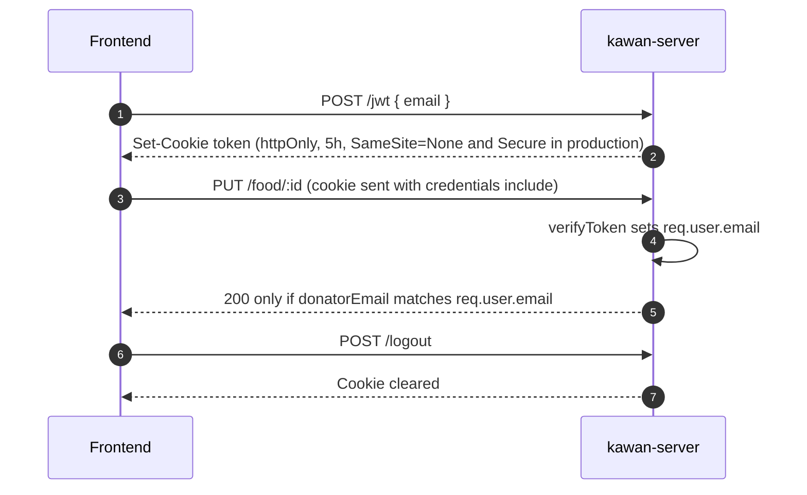

# API Reference

| Environment | Base URL |
|---|---|
| Production | `https://kawan-server.vercel.app` |
| Local | `http://localhost:5000` |

All bodies are JSON. **(auth)** means the request must carry the `token` cookie set by `POST /jwt` (send it with `credentials: 'include'`).

The **Used by** column shows which frontend calls each endpoint today. Endpoints marked "not used yet" work on the server, but no screen calls them yet (see [Known limitations](../README.md#known-limitations)).

## System and auth

| Method | Endpoint | Body | Description | Used by |
|---|---|---|---|---|
| `GET` | `/` | | Health check: `kawan server is running` | |
| `POST` | `/jwt` | `{ email }` | Signs a 5 h JWT and sets it as an `httpOnly` cookie | not used yet |
| `POST` | `/logout` | | Clears the cookie | not used yet |
| `GET` | `/videosdk-token` | | `{ token }` for VideoSDK (HS256, 2 h, `allow_join`) | client |

## AI chatbot

| Method | Endpoint | Body | Response | Used by |
|---|---|---|---|---|
| `POST` | `/chat` | `{ message, history?, mood? }` | `{ response, model }` | client |

- `message`: string, at most 2000 characters. (`query` is also accepted for older clients.)
- `history`: `[{ role: "user" \| "model", text }]`; only the last 12 turns are used.
- `mood` (optional, from the mood check-in): `{ mood, confidence, scores: { happy: 0.8, … }, recent: [{ mood, at }] }`. `mood` must be one of `neutral, happy, sad, angry, fearful, disgusted, surprised`.

| Status | Meaning |
|---|---|
| `400` | Empty or too-long message |
| `429` | Every model is rate-limited; try again in a minute |
| `500` | `GEMINI_API_KEY` is not set |
| `502` | Every model failed |

```bash
curl -X POST http://localhost:5000/chat \
  -H "Content-Type: application/json" \
  -d '{"message":"I feel stressed before exams","history":[]}'
# {"response":"That sounds really tough...","model":"gemini-3.5-flash-lite"}
```

## Professionals and verification

| Method | Endpoint | Description | Used by |
|---|---|---|---|
| `POST` | `/professionals` | Register `{ name, email, isVerify: false }` | client (sign-up) |
| `GET` | `/professionals/:email` | Role check: `status` 2 verified, 1 unverified, 0 regular user (404) | client, admin |
| `POST` | `/professionals-verify-request` | Submit `{ name, email, degreeDetails, driveLink, portfolioLink, linkedinLink }` | not used yet |
| `GET` | `/check-verify-req/:email` | `status` 1 if a request exists, otherwise 0 | not used yet |
| `GET` | `/req-professionals` | List pending verification requests | admin |
| `DELETE` | `/req-professionals/:email` | Remove a request | admin |
| `PUT` | `/accept-professionals/:email` | Set `isVerify: true` (upsert) | admin |
| `PUT` | `/delete-professionals/:email` | Set `isVerify: false` (upsert) | admin |
| `GET` | `/verify-professionals-list` | List verified professionals | admin |
| `POST` | `/professionals-manage` | Add to the verified list | admin |
| `DELETE` | `/professionals-manage/:email` | Remove from the verified list | admin |

## Counselling sessions

None of these are called by a frontend yet.

| Method | Endpoint | Description |
|---|---|---|
| `POST` | `/req-counselling` | Create a session request `{ userEmail, professionalEmail, … }` |
| `GET` | `/req-live-u/:email` | Requests made by a user |
| `GET` | `/req-live-uss/:email` | Requests sent to a professional |
| `GET` | `/req-live-p/:email` | Requests sent to a professional (duplicate of the above) |
| `DELETE` | `/req-live-delete/:email?userEmail=` | Delete one request between that professional and user |
| `DELETE` | `/req-live-pr/:email` | Delete a **verification** request (despite its name) |
| `POST` | `/live` | Store an accepted session |
| `GET` | `/live-details-user/:email` | A user's accepted sessions |
| `GET` | `/live-details-professor/:email` | A professional's accepted sessions |

## Contact and rewards

| Method | Endpoint | Description | Used by |
|---|---|---|---|
| `POST` | `/contact` | Save `{ name, email, message }` | client |
| `GET` | `/contact` | List messages | admin |
| `DELETE` | `/contact/:email` | Delete a message | admin |
| `POST` | `/coin` | Save a reward record | not used yet |

## Food sharing (legacy)

Left over from an earlier food-donation module. None of the current frontends call it.

| Method | Endpoint | Description |
|---|---|---|
| `GET` | `/food`, `/food/:id`, `/available-foods` | List or get foods |
| `POST` | `/food` (auth) | Add a food item (`status` defaults to `available`) |
| `PUT` | `/food/:id` (auth) | Update; only the donator can |
| `DELETE` | `/food/:id` (auth) | Delete; only the donator can |
| `POST` | `/request-food` | Request an item and mark it `requested` (`409` if already taken) |
| `GET` | `/food-requests?userEmail=` (auth) | The logged-in user's requests (`403` for another email) |

### Cookie JWT flow


