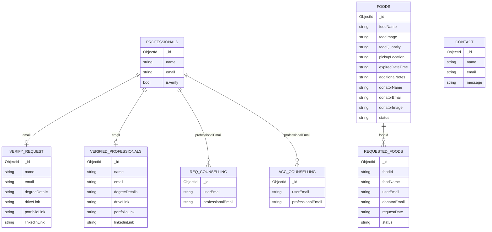

# Database

KAWAN Server uses one MongoDB Atlas database, **`kawanDB`**. Documents have no schema, so the server stores whatever body it receives. This page lists only the fields that the server or one of the frontends actually reads or writes.

User profiles and the e-book catalogue are **not** stored here. They belong to the separate KAWAN REST API (`kawan.onrender.com/api/v1`).

## Entity relationships

Collections are linked by **email address**, not by ObjectId references.

## Collections

| Collection | Purpose | Written by | Read by |
|---|---|---|---|
| `professionals` | Every account that signed up as a professional, with its `isVerify` flag | client sign-up (`POST /professionals`), admin accept/revoke (`PUT …`) | client and admin role check (`GET /professionals/:email`) |
| `verify-request` | Verification queue: degree details plus Drive, portfolio and LinkedIn links | `POST /professionals-verify-request` (no client form yet, see below) | admin verification page |
| `verified-professionals` | Approved professionals | admin accept (`POST /professionals-manage`) | admin management page |
| `req-counselling` | Session requests from a user to a professional | `POST /req-counselling` (no client UI yet) | `/req-live-*` endpoints |
| `acc-counselling` | Accepted sessions | `POST /live` (no client UI yet) | `/live-details-*` endpoints |
| `all-counselling` | Reserved for completed sessions | (unused) | (unused) |
| `contact` | Contact Us messages: `name`, `email`, `message` | client Contact Us page | admin Manage Contact page |
| `coin` | Reward coins (shape not defined) | `POST /coin` (no client UI yet) | (unused) |
| `foods`, `requestedFoods` | Legacy food sharing module | `/food`, `/request-food` | `/food*`, `/available-foods` |

## Role status codes

`GET /professionals/:email` maps documents to the role codes both frontends use:

| Condition | `status` | Meaning |
|---|---|---|
| Document exists, `isVerify: true` | `2` | Verified professional |
| Document exists, `isVerify` false or missing | `1` | Unverified professional |
| No document (HTTP 404) | `0` | Regular user |

## Notes

- Lookups and deletes use `email` as the key, but there are **no unique indexes**, so duplicate emails are possible. `DELETE` endpoints remove only the first match.
- `PUT /accept-professionals/:email` and `PUT /delete-professionals/:email` use `upsert: true`, so they create a `professionals` document if none exists.
